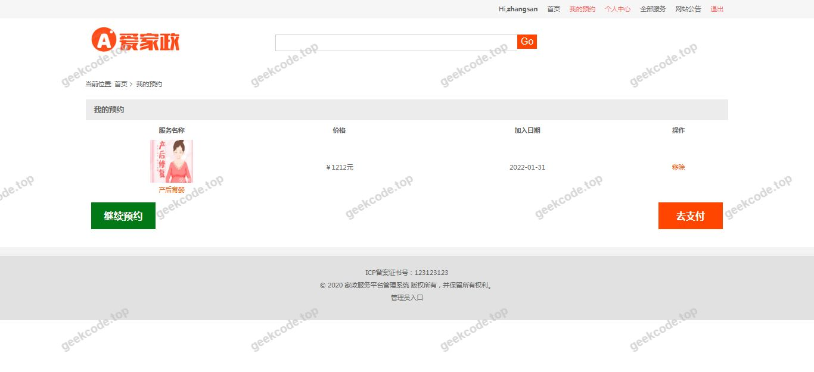
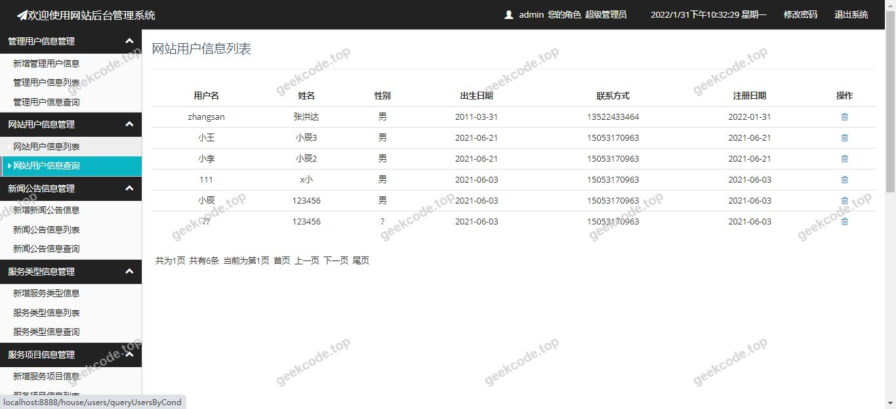
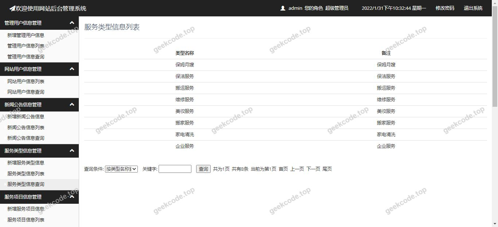
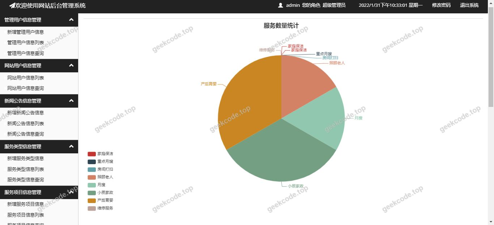

# java精品项目-基于ssm的家政服务网站系统

> 🎓 **计算机毕业设计 · java精品项目-基于ssm的家政服务网站系统**
>
> 本仓库只放**项目介绍 + 运行截图**（截图是站点带水印的原图，存在仓库 `images/` 里）。
>
> 👉 **完整可运行源码 / 数据库脚本 / 部署文档：[点我获取](https://geekcode.top/archives/java%E7%B2%BE%E5%93%81%E9%A1%B9%E7%9B%AE-%E5%9F%BA%E4%BA%8Essm%E7%9A%84%E5%AE%B6%E6%94%BF%E6%9C%8D%E5%8A%A1%E7%BD%91%E7%AB%99%E7%B3%BB%E7%BB%9F?utm_source=github)**
>
> 💬 咨询微信：**ir9372**　|　🌐 更多项目：[极客代码 geekcode.top](https://geekcode.top/?utm_source=github)
>
> 📌 项目详情页：<https://geekcode.top/archives/java%E7%B2%BE%E5%93%81%E9%A1%B9%E7%9B%AE-%E5%9F%BA%E4%BA%8Essm%E7%9A%84%E5%AE%B6%E6%94%BF%E6%9C%8D%E5%8A%A1%E7%BD%91%E7%AB%99%E7%B3%BB%E7%BB%9F?utm_source=github>

<table><td width="230" align="center"> <b>扫码加微信 ir9372</b></td><td valign="middle">📦 源码 = 项目介绍 + 全部运行截图 + 数据库 + 部署文档 👉 点上方任意截图，直接跳到 <b>极客代码 geekcode.top</b> 详情页</td></table>

---

<h1>java精品项目-基于ssm的家政服务网站系统</h1>
<h2>项目概述</h2>

本项目为“基于ssm的家政服务网站系统”，旨在构建一个高效、稳定的家政服务平台后端支撑体系。尽管项目名称提及SSM，但实际技术架构已演进为现代化的Spring Boot生态，结合MyBatis进行数据持久化。核心业务涵盖家政商品管理、订单处理、服务派单（Allot）、员工管理（Employ）及文章资讯发布等模块。系统通过JWT实现无状态认证，利用Redis提升缓存性能，并集成Elasticsearch支持全文检索，RabbitMQ用于异步消息解耦。该项目主要面向家政公司管理人员及运营人员，提供后台数据处理与业务逻辑支撑能力，适用于需要高并发处理及复杂搜索场景的家政服务数字化管理需求。

<h2>技术架构</h2>
<h3>前后端架构描述</h3>

根据代码上下文分析，本项目采用<strong>后端主导</strong>的架构模式。虽然依赖中包含 <code>tomcat-embed-jasper</code> 暗示可能保留部分JSP视图渲染能力或作为遗留兼容层，但核心交互逻辑完全由RESTful API驱动。前端界面（截图所示）通过HTTP请求调用后端Controller接口获取数据并渲染。后端使用Spring Boot框架快速搭建，通过 <code>spring-boot-starter-web</code> 提供Web服务能力。鉴权机制采用 <code>spring-boot-starter-security</code> 配合 JWT（JSON Web Token），实现基于Token的用户身份验证与权限控制，确保接口的安全性。

<h3>数据库设计要点</h3>

数据持久层主要依赖 <strong>MyBatis</strong> (<code>mybatis-spring-boot-starter</code>) 和 <strong>JPA</strong> (<code>spring-boot-starter-data-jpa</code>)。这种混合模式允许在简单CRUD操作中使用JPA提高开发效率，而在复杂查询或多表关联时使用MyBatis灵活编写SQL。核心数据实体包括：

<ol>
<li><strong>用户/管理员信息</strong>：存储账号、密码哈希、角色标识。</li>
<li><strong>家政服务商品 (Goods/Items)</strong>：记录服务项目、价格、分类 (Cate)。</li>
<li><strong>订单信息 (Orders)</strong>：包含订单状态、支付详情、关联的服务项。</li>
<li><strong>员工/服务人员 (Employ)</strong>：记录服务人员资质、当前状态。</li>
<li><strong>派单记录 (Allot)</strong>：关联订单与服务人员，记录分配结果。</li>
<li><strong>文章内容 (Article)</strong>：用于展示平台公告或家政知识。</li>
</ol>
<h3>核心技术选型理由</h3>
<ul>
<li><strong>Spring Boot</strong>: 简化配置，内嵌服务器，快速启动，适合微服务或单体应用快速迭代。</li>
<li><strong>Redis</strong>: 用于缓存热点数据（如商品列表、用户会话），减轻数据库压力，提升响应速度。</li>
<li><strong>Elasticsearch</strong>: 针对家政服务名称、描述等非结构化数据进行全文索引，提供高性能搜索体验。</li>
<li><strong>RabbitMQ</strong>: 处理订单创建、支付回调、派单通知等异步任务，实现业务解耦，提高系统吞吐量。</li>
<li><strong>Alipay SDK</strong>: 集成支付宝支付功能，满足商业闭环需求。</li>
</ul>
<h2>功能模块</h2>

根据提供的Controller列表及截图中的系统运行界面，系统主要包含以下功能模块。注意：由于明确标注“是否有前台: 否”、“是否有后台: 否”且路由为空，此处功能模块指代的是<strong>后端API所支撑的业务逻辑单元</strong>，截图展示的“front”界面实为这些API数据的可视化呈现或测试页面。

<h3>1. 基础管理与认证模块</h3>
<ul>
<li><strong>AdminController</strong>: 负责管理员账户的增删改查、登录状态管理及权限配置。</li>
<li><strong>BaseController</strong>: 提供通用的响应封装、异常处理及公共工具方法，作为其他Controller的父类或辅助组件。</li>
<li><strong>IndexController</strong>: 处理系统首页数据加载、全局导航配置或欢迎页逻辑。</li>
</ul>
<h3>2. 家政服务核心业务模块</h3>
<ul>
<li><strong>GoodsController / ItemsController</strong>: </li>
<li>管理家政服务项目的上架、下架、库存（如有）、价格调整。</li>
<li>支持按分类筛选、关键字搜索（结合Elasticsearch）。</li>
<li><strong>CateController</strong>: </li>
<li>维护家政服务分类树（如保洁、月嫂、维修等），支持分类的新增、编辑与排序。</li>
<li><strong>EmployController</strong>: </li>
<li>管理服务人员的档案信息，包括姓名、技能标签、联系方式、在职状态。</li>
<li>支持服务人员信息的审核与更新。</li>
</ul>
<h3>3. 订单与交易模块</h3>
<ul>
<li><strong>OrdersController</strong>: </li>
<li>处理订单的创建、查询、取消及状态流转（待支付、已支付、服务中、已完成）。</li>
<li>关联用户与服务人员，记录订单明细。</li>
<li><strong>AliPayController</strong>: </li>
<li>对接支付宝支付网关，处理预下单、支付回调通知、退款申请等资金相关业务逻辑。</li>
</ul>
<h3>4. 调度与内容模块</h3>
<ul>
<li><strong>AllotController</strong>: </li>
<li>实现订单到服务人员的智能或人工派单逻辑。</li>
<li>记录派单历史，支持重新分配或撤销派单。</li>
<li><strong>ArticleController</strong>: </li>
<li>管理系统发布的新闻资讯、服务指南或公告文章。</li>
<li>支持富文本编辑内容的存储与展示。</li>
<li><strong>ChartController</strong>: </li>
<li>提供数据统计接口，返回图表所需的数据格式（如每日订单量、热门服务排行），用于前端可视化大屏展示。</li>
</ul>
<h2>用户角色与权限</h2>

基于 <code>AdminController</code>、<code>EmployController</code> 及 Spring Security + JWT 的实现，系统主要涉及以下角色及其权限范围：

<table>
<thead>
<tr>
<th align="left">角色</th>
<th align="left">权限描述</th>
<th align="left">可访问/操作的功能模块</th>
</tr>
</thead>
<tbody><tr>
<td align="left"><strong>超级管理员</strong></td>
<td align="left">拥有系统最高权限，可进行全量数据管理和配置。</td>
<td align="left">- <strong>所有模块</strong>：Admin, AliPay, Allot, Article, Cate, Chart, Employ, Goods, Index, Items, Orders。- <strong>用户管理</strong>：创建/删除其他管理员账号。- <strong>系统配置</strong>：修改支付参数、查看全量日志。</td>
</tr>
<tr>
<td align="left"><strong>普通管理员/运营人员</strong></td>
<td align="left">负责日常业务运营，无系统底层配置权限。</td>
<td align="left">- <strong>业务管理</strong>：Goods, Items, Cate, Article。- <strong>订单处理</strong>：Orders (查看、手动干预), Allot (派单)。- <strong>人员管理</strong>：Employ (查看、审核)。- <strong>数据查看</strong>：Chart (报表查看)。- <strong>不可访问</strong>：AdminController (不能管理其他管理员), AliPay (通常仅查看流水，不配置密钥)。</td>
</tr>
<tr>
<td align="left"><strong>服务人员 (Employee)</strong></td>
<td align="left">若系统开放独立入口或通过特定Token识别，仅能查看与自己相关的任务。</td>
<td align="left">- <strong>个人任务</strong>：Allot (接收派单), Orders (查看关联自己的订单详情)。- <strong>个人信息</strong>：Employ (更新个人资料)。- <strong>不可访问</strong>：任何管理性接口 (Admin, Cate, Article发布等)。</td>
</tr>
<tr>
<td align="left"><strong>游客/未登录用户</strong></td>
<td align="left">仅具备浏览公开信息的权限。</td>
<td align="left">- <strong>公开数据</strong>：Index (首页), Goods/Items (浏览商品), Cate (浏览分类), Article (阅读文章)。- <strong>不可访问</strong>：Orders, Allot, Admin, Employ 等私有或敏感接口。</td>
</tr>
</tbody></table>

<em>注：具体权限粒度取决于Security配置的URL拦截规则，上述基于常规企业级系统设计推导。</em>

<h2>项目特色与创新点</h2>
<ol>
<li><strong>混合持久化策略</strong>：同时引入 MyBatis 和 JPA，既保留了传统SSM项目中SQL控制的灵活性，又利用了JPA在对象映射上的便捷性，适应不同复杂度的业务场景。</li>
<li><strong>高性能搜索与缓存</strong>：集成 Elasticsearch 和 Redis。对于家政服务这类描述性强、关键词多样的业务，ES提供了比传统LIKE查询更高效、更准确的搜索体验；Redis则有效缓解了高频访问带来的数据库IO瓶颈。</li>
<li><strong>异步消息驱动架构</strong>：引入 RabbitMQ 处理订单状态变更、支付回调及派单通知。这种事件驱动的设计使得系统在应对高并发下单或批量派单时，能够保持主线程的非阻塞，显著提升了系统的吞吐量和稳定性。</li>
<li><strong>安全的无状态认证</strong>：采用 JWT 替代传统的 Session/Cookie 方案，便于分布式部署扩展，同时结合 Spring Security 实现了细粒度的接口权限控制，保障了家政数据（如客户电话、地址）的安全性。</li>
<li><strong>完整的商业闭环支持</strong>：原生集成 Alipay SDK，从商品展示、下单、支付到派单、服务完成，形成了完整的家政服务O2O业务流支撑能力。</li>
</ol>
<h2>部署环境</h2>

为确保系统正常运行，需准备以下软件及硬件环境：

<ul>
<li><strong>操作系统</strong>: Linux (CentOS 7+/Ubuntu 20.04+) 或 Windows Server 2016+。</li>
<li><strong>Java 运行时</strong>: JDK 1.8 或 JDK 11 (推荐LTS版本，以匹配Spring Boot 2.x/3.x兼容性)。</li>
<li><strong>数据库</strong>: MySQL 5.7 或 MySQL 8.0 (需启用InnoDB引擎)。</li>
<li><strong>缓存中间件</strong>: Redis 5.0+ (建议开启持久化配置)。</li>
<li><strong>搜索引擎</strong>: Elasticsearch 7.x (版本需与客户端库兼容)。</li>
<li><strong>消息队列</strong>: RabbitMQ 3.8+ (需安装管理插件以便监控)。</li>
<li><strong>Web容器</strong>: 内置 Tomcat (由 <code>spring-boot-starter-web</code> 提供)，无需单独安装外部Tomcat，但生产环境建议配合 Nginx 做反向代理。</li>
<li><strong>构建工具</strong>: Maven 3.6+。</li>
<li><strong>其他依赖</strong>: </li>
<li>支付宝沙箱/正式环境账号及密钥对。</li>
<li>SMTP邮件服务器配置 (因依赖 <code>spring-boot-starter-mail</code>，可能用于发送注册验证码或订单通知)。</li>
</ul>
<h2>五、技术特性</h2>
<ul>
<li>服务端模板渲染（JSP）</li>
<li>采用 JWT Token 机制实现无状态认证</li>
<li>使用 Redis 缓存提升系统性能</li>
</ul>
<h2>六、功能模块截图</h2>
<h3>前台用户端</h3>
<h4>系统运行界面1</h4>

<h4>系统运行界面2</h4>

<h4>系统运行界面3</h4>

<h4>系统运行界面4</h4>

<h4>系统运行界面5</h4>

<h4>系统运行界面6</h4>

<h4>系统运行界面7</h4>

<h4>系统运行界面8</h4>

---

## 获取完整源码

| 项目 | 说明 |
| --- | --- |
| 项目名 | java精品项目-基于ssm的家政服务网站系统 |
| 运行截图 | 本文 8 张（站点带水印原图，仓库 `images/` 目录） |
| 完整源码 | [https://geekcode.top/archives/java%E7%B2%BE%E5%93%81%E9%A1%B9%E7%9B%AE-%E5%9F%BA%E4%BA%8Essm%E7%9A%84%E5%AE%B6%E6%94%BF%E6%9C%8D%E5%8A%A1%E7%BD%91%E7%AB%99%E7%B3%BB%E7%BB%9F?utm_source=github](https://geekcode.top/archives/java%E7%B2%BE%E5%93%81%E9%A1%B9%E7%9B%AE-%E5%9F%BA%E4%BA%8Essm%E7%9A%84%E5%AE%B6%E6%94%BF%E6%9C%8D%E5%8A%A1%E7%BD%91%E7%AB%99%E7%B3%BB%E7%BB%9F?utm_source=github) |
| 咨询微信 | **ir9372**（备注：jingpin-yuanma） |
| 更多项目 | [极客代码 geekcode.top](https://geekcode.top/?utm_source=github) |

> 需要源码、部署、改配置、跑不起来等问题，加微信 ir9372 沟通，说明项目名即可。
